# Uniformes 6M

Sistema web de gestão de uniformes escolares. Registra a entrada dos lotes do fornecedor (com nota fiscal), a entrega dos uniformes a cada aluno, acompanha o saldo de cada tipo, tamanho e sexo, avisa o que está acabando, registra a requisição de reposição e emite em segundos os relatórios em PDF ou CSV usados na prestação de contas.

Diferente de uma planilha, o saldo nunca é digitado: ele sobe com o lote e desce com a entrega, na mesma transação, e o sistema não deixa entregar uma peça que não existe.

## Sumário

- [Módulos](#módulos)
- [Stack e por quê](#stack-e-por-quê)
- [Como rodar](#como-rodar)
- [Credenciais de demonstração](#credenciais-de-demonstração)
- [Telas](#telas)
- [Modelagem](#modelagem)
- [Documentação](#documentação)
- [Testes](#testes)
- [Equipe](#equipe)

## Módulos

| Módulo | O que faz |
| ------ | --------- |
| **Autenticação e conta** | Cadastro, login com JWT (10 h), troca de senha com confirmação da senha atual, edição dos dados. Sessão expirada (API responde `401`) volta ao login com aviso. |
| **Visão geral** | Peças em estoque, entregas do mês, alunos, tamanhos esgotados, matriz de estoque por tamanho, últimas entregas e o card **Repor primeiro**, com botão **Solicitar**. |
| **Entradas (lotes)** | Lote do fornecedor com chave da NF-e (única), data e itens lançados em linhas ou em grade tamanho × sexo. O estoque sobe; linhas repetidas são somadas; correções não deixam o saldo negativo. |
| **Entregas** | Peças entregues a um aluno. O estoque desce; o catálogo bloqueia tamanhos sem saldo e a API recusa quantidade acima do estoque e aluno que saiu da escola. |
| **Estoque** | Cada combinação tipo + tamanho + sexo com a situação **Esgotado** / **Baixo** / **OK**. O limite de "baixo" é definido **por tipo de uniforme** (`quantidade <= limite`), calculado pela VIEW `vw_estoque`. |
| **Requisições de novos uniformes** | Registro do que precisa ser pedido ao fornecedor, com status pendente → atendida ou cancelada. Não mexe no estoque (as peças entram pelo lote). |
| **Alunos e turmas** | Cadastro com responsável e telefone; busca por nome ou turma sem diferenciar acentos; filtro por situação. **Registrar saída** desliga o aluno que deixou a escola sem apagar o histórico; excluir só vale para cadastro feito por engano. |
| **Tipos de uniforme** | Catálogo de peças com o limite de estoque baixo de cada uma. |
| **Relatórios** | Estoque, entradas, saídas, entregas por turma (com subtotal) e transações, por mês, intervalo ou ano, em **PDF ou CSV**. Período sem dados gera o arquivo com "Nenhum registro encontrado". |

O detalhamento de público, escopo e critérios de sucesso está no [documento de visão do produto](./docs/visao-do-produto.md).

## Stack e por quê

| Camada | Tecnologia | Por quê (resumo) |
| ------ | ---------- | ---------------- |
| Backend | Java 25 + Spring Boot 4 (Web, Data JPA, Security, Validation) | Ecossistema maduro e conhecido do time; transações declarativas e validação prontas. |
| Banco | PostgreSQL 18 + Flyway (migrations V1–V5) | Domínio relacional e saldo que exige transação, `CHECK`, enums nativos e `SELECT … FOR UPDATE`. |
| Relatórios | OpenPDF + CSV próprio | Licença livre, layout padronizado gerado no servidor; CSV abre direto no Excel. |
| Frontend | React 19 + TypeScript + Vite 8 | SPA rápida, contratos da API tipados. |
| UI | Tailwind CSS 4 + shadcn/ui | Componentes acessíveis (WCAG) e customizáveis. |
| Dados no front | TanStack Query, React Hook Form + Zod | Cache e invalidação automáticos; validação declarativa com mensagens em português. |
| Infra | Docker + Docker Compose | Todos rodam o mesmo Postgres e o mesmo backend, sem instalar Java nem Postgres. |

As justificativas completas, com alternativas e consequências, estão em [decisões de modelagem](./docs/decisoes-de-modelagem.md).

## Como rodar

A ordem importa: sem a API no ar, a interface abre mas todas as telas ficam vazias.

**Pré-requisitos:** Docker (com Compose) e Node.js 20+.

**1. Backend + banco (Docker)**

```bash
cd backend
cp .env.example .env            # só na primeira vez
docker compose up -d --build    # o Flyway aplica as migrations V1 a V5
docker compose logs -f backend  # espere "Started UniformApplication" e saia com Ctrl+C
```

A API sobe em `http://localhost:8080` (Swagger em `http://localhost:8080/swagger-ui.html`).

**2. Dados de demonstração (seed)** — com a API no ar, a partir da raiz do repositório:

```bash
node backend/scripts/seed.mjs
# termina com: "Pronto. Entre com admin@uniformes6m.local / senha123"
```

Cria o usuário de demonstração, 5 tipos de uniforme, 7 turmas, 46 alunos, 2 lotes e 32 entregas, sempre pela API pública (passa pelas mesmas validações). Se o banco já tiver tipos de uniforme, não faz nada.

**3. Frontend**

```bash
cd frontend
pnpm install          # sem pnpm instalado: npx -y pnpm@10 install
cp .env.example .env  # só na primeira vez
pnpm dev              # ou: npx -y pnpm@10 dev
```

A interface sobe em `http://localhost:5173`. Como o Vite escuta em `0.0.0.0`, outros dispositivos da rede local acessam por `http://IP_DA_MAQUINA:5173`; nesse caso ajuste `VITE_API_URL=http://IP_DA_MAQUINA:8080/api` em `frontend/.env`.

Para recomeçar do zero: `cd backend && docker compose down -v` (apaga o volume do banco) e repita os passos.

## Credenciais de demonstração

Depois de rodar o seed:

| Email | Senha |
| ----- | ----- |
| `admin@uniformes6m.local` | `senha123` |

Sem o seed, o banco começa vazio: crie um usuário em `/register`.

## Telas

Capturas da interface com os dados de demonstração (todas em [`docs/screenshots/`](./docs/screenshots/)).

| | |
|---|---|
| **Visão geral (dashboard)**<br>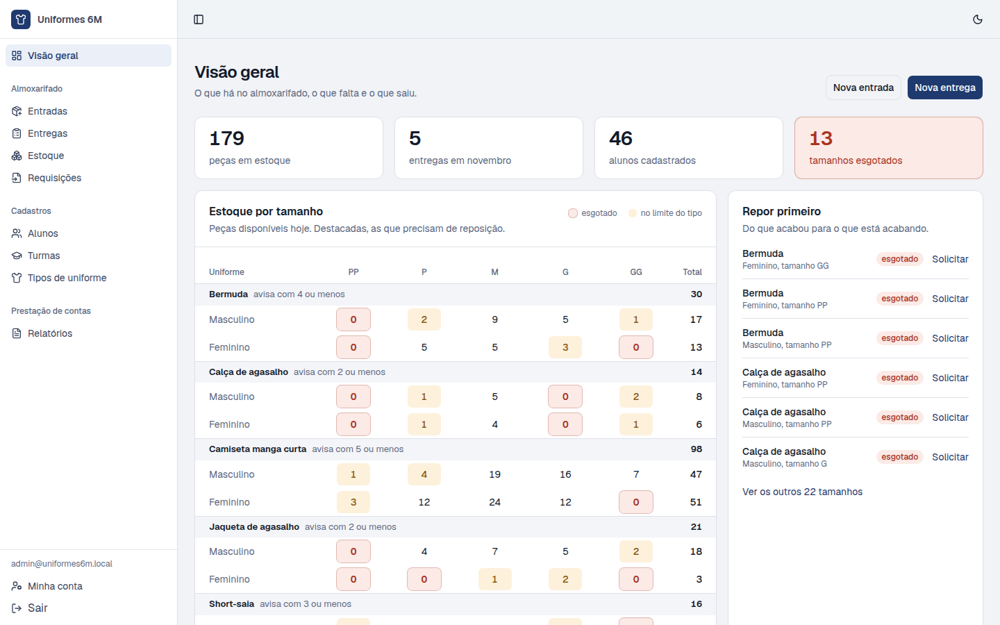 | **Nova entrega**<br>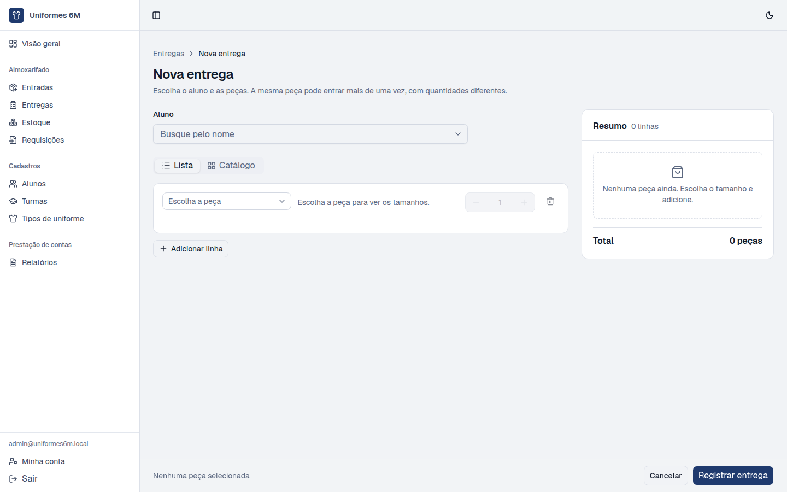 |
| **Estoque**<br>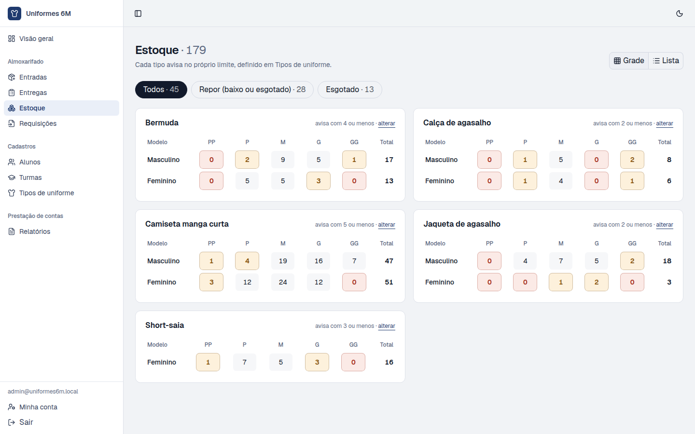 | **Requisições em andamento**<br>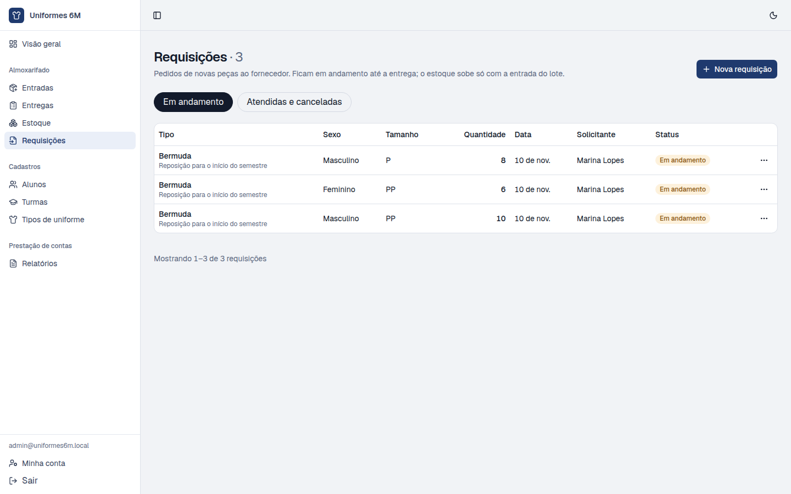 |
| **Nova requisição**<br>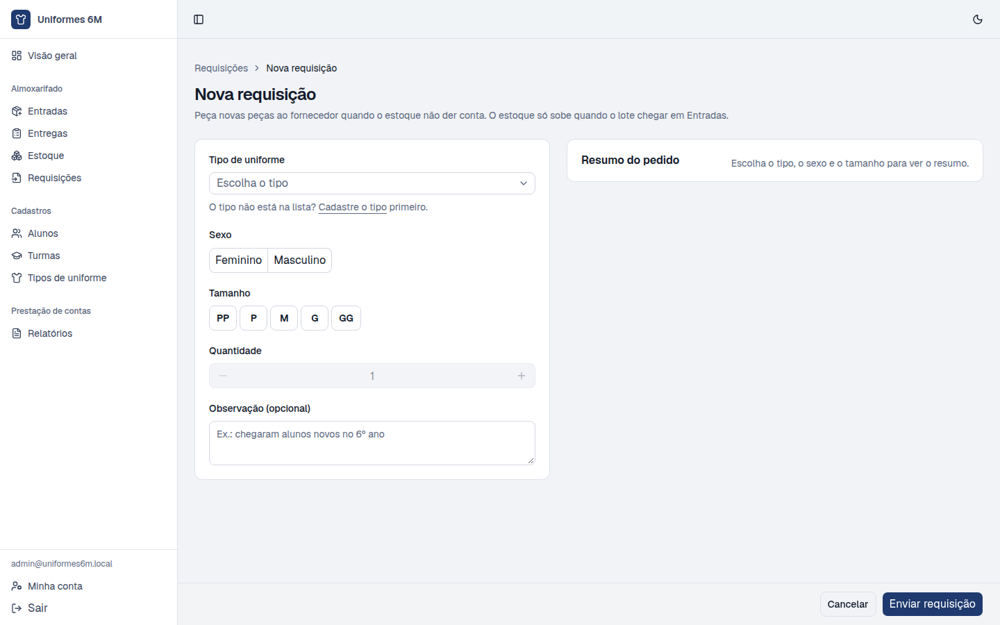 | **Registrar saída do aluno**<br>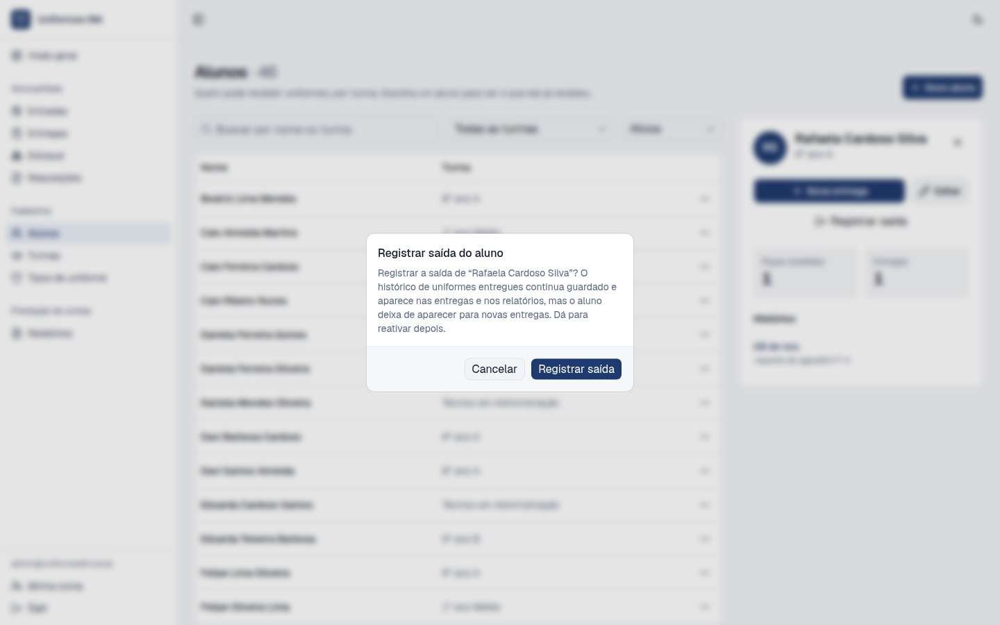 |
| **Ficha de aluno desligado**<br>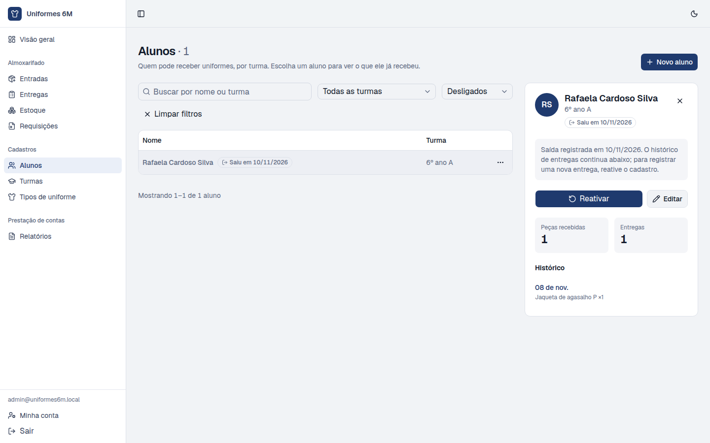 | **Relatórios (PDF ou CSV)**<br>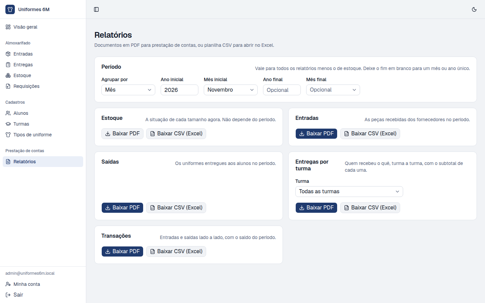 |

**Celular** (layout responsivo):

| Visão geral (dashboard) | Menu lateral | Estoque | Nova entrega | Alunos |
|---|---|---|---|---|
| 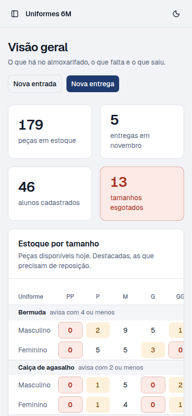 | 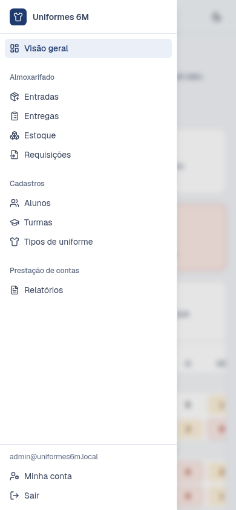 | 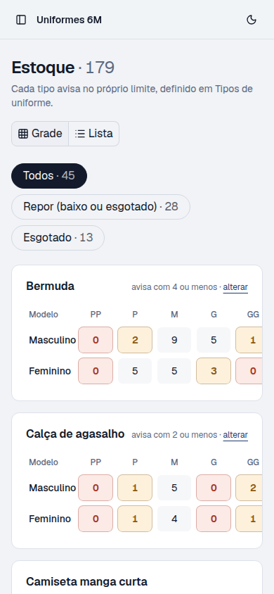 | 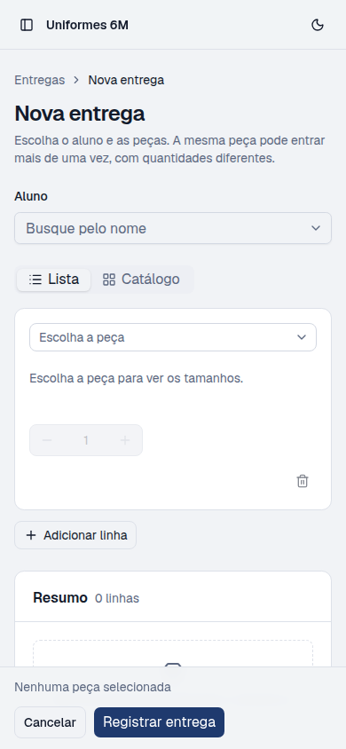 | 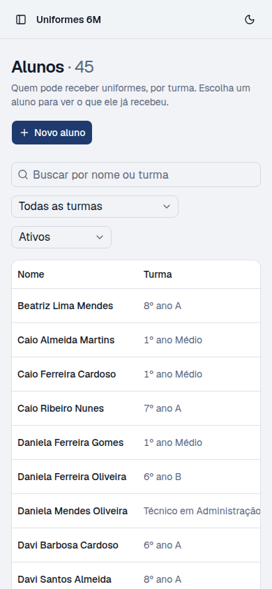 |

<details>
<summary>Todas as outras telas</summary>

- [Login](./docs/screenshots/01-login.png)
- [Login com erro de validação](./docs/screenshots/02-login-erro-validacao.png)
- [Cadastro de usuário](./docs/screenshots/03-cadastro-usuario.png)
- [Trocar senha (exige a senha atual)](./docs/screenshots/04-trocar-senha.png)
- [Página não encontrada](./docs/screenshots/05-pagina-nao-encontrada.png)
- [Entregas](./docs/screenshots/07-entregas.png)
- [Detalhe da entrega](./docs/screenshots/08-entrega-detalhe.png)
- [Nova entrega com erro de validação](./docs/screenshots/10-nova-entrega-erro-validacao.png)
- [Entradas (lotes)](./docs/screenshots/11-entradas.png)
- [Detalhe da entrada](./docs/screenshots/12-entrada-detalhe.png)
- [Nova entrada](./docs/screenshots/13-nova-entrada.png)
- [Nova requisição com erro de validação](./docs/screenshots/17-nova-requisicao-erro-tamanho.png)
- [Alunos com filtro de situação](./docs/screenshots/18-alunos-filtro-situacao.png)
- [Ficha do aluno](./docs/screenshots/19-aluno-detalhe.png)
- [Alunos que saíram da escola](./docs/screenshots/21-alunos-desligados.png)
- [Novo aluno](./docs/screenshots/23-novo-aluno.png)
- [Editar aluno](./docs/screenshots/24-editar-aluno.png)
- [Turmas](./docs/screenshots/25-turmas.png)
- [Nova turma](./docs/screenshots/26-nova-turma.png)
- [Tipos de uniforme](./docs/screenshots/27-tipos-uniforme.png)
- [Novo tipo de uniforme](./docs/screenshots/28-novo-tipo-uniforme.png)
- [Conta](./docs/screenshots/30-conta.png)

</details>

## Modelagem

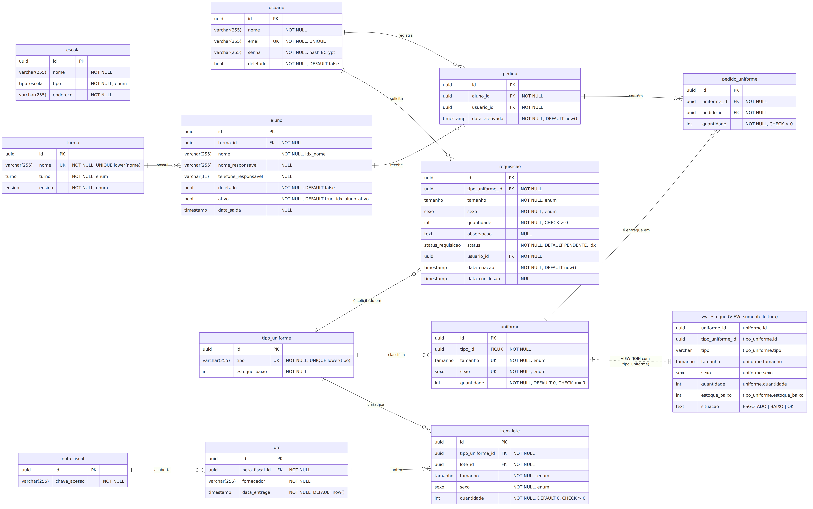

12 tabelas e a VIEW `vw_estoque`, geradas pelas migrations Flyway em [`backend/src/main/resources/db/migration/`](./backend/src/main/resources/db/migration/).

- [ERD.md](./docs/ERD.md) — diagrama Mermaid, cardinalidades, dicionário de dados, enums e a VIEW.
- [ddl.sql](./docs/ddl.sql) — DDL completo (V1 a V5 concatenadas).
- [decisoes-de-modelagem.md](./docs/decisoes-de-modelagem.md) — por que o banco é assim.

## Documentação

| Documento | Conteúdo |
| --------- | -------- |
| [docs/visao-do-produto.md](./docs/visao-do-produto.md) | Problema, personas, escopo, fora de escopo e critérios de sucesso. |
| [docs/endpoints.md](./docs/endpoints.md) | Todos os endpoints da API, com parâmetros, exemplos, erros e tabela-resumo. |
| [docs/ERD.md](./docs/ERD.md) | Modelo de dados: diagrama, dicionário, enums e VIEW `vw_estoque`. |
| [docs/DER.png](./docs/DER.png) | Imagem do diagrama entidade-relacionamento. |
| [docs/ddl.sql](./docs/ddl.sql) | DDL completo do banco. |
| [docs/decisoes-de-modelagem.md](./docs/decisoes-de-modelagem.md) | Decisões de modelagem, arquitetura, segurança e stack. |
| [docs/relatorio-qualidade.md](./docs/relatorio-qualidade.md) | Relatório de qualidade (testes, casos de teste e evidências em `docs/qa/`). |
| [docs/roteiro-apresentacao.md](./docs/roteiro-apresentacao.md) | Roteiro da apresentação final e perguntas da banca. |
| [backend/BACKEND.md](./backend/BACKEND.md) | Como rodar e testar o backend, autenticação e formato de erro. |
| [frontend/README.md](./frontend/README.md) | Rotas, alertas de estoque, estrutura e testes do frontend. |

## Testes

| Parte | Comando | Quantidade |
| ----- | ------- | ---------- |
| Backend | `cd backend && ./gradlew test` | **235** testes (JUnit 5 + Mockito; integração com Testcontainers e Postgres real — precisa do Docker) |
| Frontend | `cd frontend && pnpm test` | **86** testes (Vitest + Testing Library) |

Os testes de integração do backend (`FluxoCompletoIntegrationTest`, `SegurancaIntegrationTest`, `AlunoSaidaIntegrationTest`) sobem um Postgres em container e aplicam as mesmas migrations da aplicação.

## Equipe

| Integrante | Papel |
| ---------- | ----- |
| Rafael | Back-end e Banco de Dados |
| Gabriel Witor | Front-end e Integração |
| Giovana | Design de Interface e UX |
| Pedro | Product Owner |
| Ana Júlia | QA |
| Juliana | Scrum Master |
