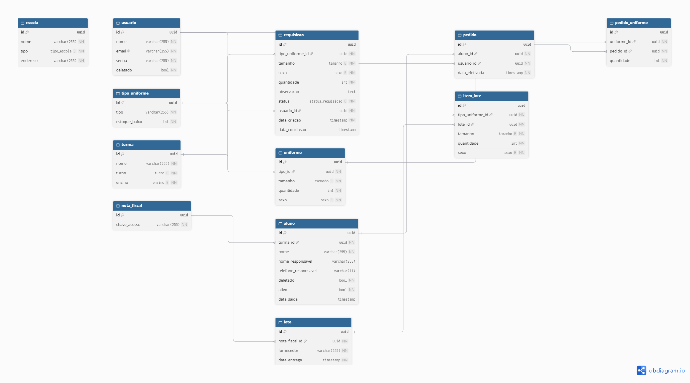

# 6M Uniformes - Backend

Sistema de gestão de uniformes escolares. API REST desenvolvida em Java, responsável por autenticação, gestão de usuários, escolas, turmas, alunos (inclusive a saída da escola), uniformes, notas fiscais, lotes de entrada, entregas, requisições de novas peças e geração de relatórios em PDF ou CSV.

## Sumário

- [Tecnologias](#tecnologias)
- [Como rodar o projeto](#como-rodar-o-projeto)
- [Base URL](#base-url)
- [Banco de dados](#banco-de-dados)
- [Documentação da API](#documentação-da-api)
- [Autenticação](#autenticação)
- [Formato de erro](#formato-de-erro)
- [Padrões usados no código](#padrões-usados-no-código)
- [Testes](#testes)
- [Rodando o Postgres isoladamente (sem o backend)](#rodando-o-postgres-isoladamente-sem-o-backend)
- [Outros READMEs do projeto](#outros-readmes-do-projeto)

---

## Tecnologias

- **Java 25**
- **Spring Boot** (Web, Data JPA, Security, Validation)
- **PostgreSQL 18**
- **Flyway** (migrações de banco)
- **JWT** (autenticação stateless via `java-jwt`)
- **springdoc-openapi / Swagger** (documentação interativa da API)
- **OpenPDF** (relatórios em PDF) e `CsvTableBuilder` próprio (relatórios em CSV)
- **JUnit 5 + Mockito** (testes unitários)
- **Testcontainers** (testes de integração com Postgres real)
- **Docker / Docker Compose**

## Como rodar o projeto

### Pré-requisitos

- Docker instalado
- Arquivo `.env` configurado dentro do backend (veja `.env.example`)

### Subindo o projeto pela primeira vez

```bash
docker compose up -d --build
```

A API estará disponível em `http://localhost:8080`.
No `docker-compose.yml`, a porta `8080` já é publicada como `8080:8080`, permitindo acesso a partir de outros dispositivos da mesma rede local.

Para CORS, ajuste `CORS_ALLOWED_ORIGINS` no `.env`. Para testar em LAN, use `*` (apenas em testes; em produção, informe o domínio do frontend).

### Dados de demonstração

Com a API no ar, a partir da raiz do repositório:

```bash
node backend/scripts/seed.mjs   # cria admin@uniformes6m.local / senha123, tipos, turmas, alunos, lotes e entregas
```

Use `SEED_API_URL=http://host:8080/api` para apontar para outra máquina. Se o banco já tiver tipos de uniforme, o script não faz nada (`--force` ignora essa checagem).

### Verificando os logs

```bash
docker compose logs -f backend
docker compose logs -f db
```

### Atualizando o backend após mudanças no código

Sempre que alterar o código-fonte, é preciso rebuildar a imagem do backend:

```bash
docker compose up -d --build backend
```

Se quiser derrubar e recriar tudo do zero (útil se mexeu no `Dockerfile` ou `docker-compose.yml`):

```bash
docker compose down
docker compose up -d --build
```

### Apagando tudo, incluindo os dados do banco

```bash
docker compose down -v
```

⚠️ O comando acima remove o volume `uniform_data` e apaga todos os dados do Postgres.

---

## Base URL

```
http://localhost:8080/api
```

---

## Banco de dados



PostgreSQL 18 com o schema versionado pelo **Flyway** em `src/main/resources/db/migration/` (o Hibernate só valida, `ddl-auto=validate`):

| Versão | O que faz |
| ------ | --------- |
| `V1__create_initial_schema` | Enums, 11 tabelas, índices e FKs. |
| `V2__create_requisicao` | Tabela `requisicao` + enum `status_requisicao`. |
| `V3__aluno_saida` | `aluno.ativo` e `aluno.data_saida`; recupera alunos excluídos que tinham entregas. |
| `V4__view_estoque` | VIEW `vw_estoque` (situação `ESGOTADO`/`BAIXO`/`OK`). |
| `V5__corrige_datas_nulas` | `pedido.data_efetivada` e `lote.data_entrega` `NOT NULL DEFAULT now()`. |

Mudanças de schema entram sempre como uma **nova** versão — não edite migrations já aplicadas (o Flyway recusa o checksum diferente).

Documentação completa do modelo:

- [docs/ERD.md](../docs/ERD.md) — diagrama Mermaid, dicionário de dados, enums e a VIEW `vw_estoque`;
- [docs/DER.png](../docs/DER.png) — a mesma imagem acima (`backend/DER.png` é cópia dela);
- [docs/ddl.sql](../docs/ddl.sql) — DDL completo (V1 a V5);
- [docs/decisoes-de-modelagem.md](../docs/decisoes-de-modelagem.md) — por que o banco é assim.

---

## Documentação da API

Há duas fontes, com o mesmo contrato:

- **[docs/endpoints.md](../docs/endpoints.md)** — referência escrita de todos os endpoints, com exemplos reais de request/response, erros possíveis e uma tabela-resumo (inclui requisições, saída de aluno, painel de estoque e `?formato=pdf|csv` dos relatórios).
- **Swagger**, gerado automaticamente a partir do código, para testar pelo navegador:

```
http://localhost:8080/swagger-ui.html
```

Clique em **"Authorize"** no topo da página, cole o token JWT (obtido em `POST /api/auth/login`) e todas as chamadas de teste feitas por ali já enviam o header `Authorization` automaticamente.

Nos endpoints de listagem (paginados), o campo `sort` aceita o formato `campo,direção` (ex: `quantidade,desc`) — clique em "Add string item" para adicionar cada critério de ordenação como um campo separado.

O JSON puro da especificação OpenAPI (útil para gerar clientes ou importar no Postman/Insomnia) fica em:

```
http://localhost:8080/v3/api-docs
```

---

## Autenticação

A API usa **JWT** com sessão stateless. Fluxo básico:

1. `POST /api/auth/login` retorna o token JWT. **`POST /api/usuario/registrar` não retorna token** — ele só cria o usuário; depois de registrar, é preciso chamar `/auth/login` separadamente para autenticar.
2. Envie esse token em toda requisição autenticada, no header:

```
Authorization: Bearer <token>
```

Rotas públicas: `POST /api/auth/login`, `POST /api/usuario/registrar` e `PUT /api/usuario/trocar-senha` (além do Swagger). Todos os demais endpoints exigem o token, que expira em **10 horas**.

**Token ausente, inválido ou expirado → `401`** com corpo JSON (gerado por `security/RestAuthenticationEntryPoint`), e não o `403` padrão do Spring Security:

```json
{ "message": "Sessão expirada ou inválida. Entre novamente." }
```

O frontend usa esse `401` para encerrar a sessão e voltar ao login. `403` fica reservado para usuário autenticado sem permissão.

**Troca de senha.** `PUT /api/usuario/trocar-senha` não exige token (serve a quem não consegue entrar), mas exige `email`, **`senhaAtual`** e `novaSenha`. Email inexistente e senha atual errada recebem a mesma resposta (`400 Senha atual incorreta`), para não revelar quais emails estão cadastrados.

**Atualizar conta.** `PUT /api/usuario/atualizar` aceita reenviar o próprio email (só recusa email de outro usuário). Como o token identifica o usuário pelo email, trocar o email exige novo login.

---

## Formato de erro

Toda resposta de erro segue um dos dois formatos abaixo.

**Erro de negócio (`400`/`401`/`404`/`409`)** — recurso não encontrado, regra violada ou conflito (ex: email duplicado, nome de turma já existente, estoque insuficiente, recurso com vínculos que impedem exclusão, parâmetro de ordenação inválido):

```json
{
  "message": "Este email já está em uso"
}
```

**Erro de validação (`400`)** — campos do body que não passaram nas anotações de validação:

```json
{
  "message": "Validation failed",
  "errors": {
    "email": "O formato do email é inválido",
    "senha": "A senha deve ter no mínimo 6 caracteres"
  }
}
```

---

## Padrões usados no código

- IDs são sempre **UUID**, não números incrementais.
- Datas seguem o padrão ISO 8601 (ex: `"2025-06-17T14:30:00"`).
- Em endpoints autenticados, o usuário **nunca** é identificado por um campo no body — sempre pelo token:

```java
@PostMapping
public ResponseEntity<?> criar(@RequestBody PedidoRequestDTO dto,
                                @AuthenticationPrincipal Usuario usuario) {
    // usuario vem do token, não do DTO
    pedidoService.criar(dto, usuario);
}
```

---

## Testes

O projeto tem dois níveis de teste, com propósitos diferentes.

### Testes unitários

Cobrem os `Service` de cada domínio (Usuário, Escola, Turma, Aluno, Uniforme, Lote, Pedido, Requisição, Relatório, etc.), além de `JwtTokenService`, `UserDetailsServiceImpl` e `CsvTableBuilder`, isoladamente, usando **Mockito** para simular os repositories e services colaboradores. Validam regras de negócio, validações e tratamento de erro sem depender de banco de dados ou rede — por isso rodam rápido e não precisam de nenhuma ferramenta externa.

Rodar só os testes unitários:

```bash
./gradlew test --tests "com.six_m.uniform.domain.*"
```

### Testes de integração (Testcontainers)

Usam **Testcontainers** para subir um **Postgres real em um container Docker**, exclusivo para o teste, com as migrations Flyway V1–V5 aplicadas do zero — garantindo que o comportamento testado é idêntico ao ambiente real (enums nativos, a VIEW `vw_estoque`, `SELECT … FOR UPDATE`). A base comum é `AbstractIntegrationTest`.

| Classe | O que cobre |
| ------ | ----------- |
| `FluxoCompletoIntegrationTest` | Ponta a ponta: registrar, logar, criar tipo, dar entrada via lote, entregar, conferir o saldo, painel de estoque e relatórios em PDF/CSV (inclusive período vazio). |
| `SegurancaIntegrationTest` | `401` sem token, com token inválido e com token expirado; trocar senha com senha atual correta/errada/ausente sem revelar emails; atualizar a conta mantendo o próprio email. |
| `AlunoSaidaIntegrationTest` | Registrar saída e reativar; histórico preservado; nova entrega recusada para quem saiu; `DELETE` recusado para aluno com entregas e permitido sem entregas; filtros `nome`/`turmaId`/`ativo`; listagem de entregas que não quebra com aluno excluído. |

**Pré-requisito:** Docker precisa estar instalado e em execução na máquina que for rodar esses testes.

Rodar uma classe de integração:

```bash
./gradlew test --tests FluxoCompletoIntegrationTest
./gradlew test --tests SegurancaIntegrationTest
./gradlew test --tests AlunoSaidaIntegrationTest
```

Rodar todos os testes (unitários + integração) — **235 testes**:

```bash
./gradlew test
```

> **`build/` criado pelo Docker.** Se a pasta `backend/build/` tiver sido criada por um container (como root), o Gradle local falha com "permission denied". Corrija o dono antes de rodar os testes: `sudo chown -R "$USER":"$USER" backend/build` (ou apague a pasta).

---

## Rodando o Postgres isoladamente (sem o backend)

Útil para debug local:

```bash
docker run -d --name uniform -e POSTGRES_DB=uniform -e POSTGRES_USER=uniform -e POSTGRES_PASSWORD=postgresUniform -p 5432:5432 -v uniform_data:/var/lib/postgresql postgres:18-alpine
```

---

## Outros READMEs do projeto

Este README cobre apenas o **backend**. Continue lendo a documentação do projeto:

- [README do projeto](./../README.md)
- [Documentação do frontend](./../frontend/README.md)
- [Documentação dos endpoints](./../docs/endpoints.md)
- [Modelo de dados (ERD)](./../docs/ERD.md)