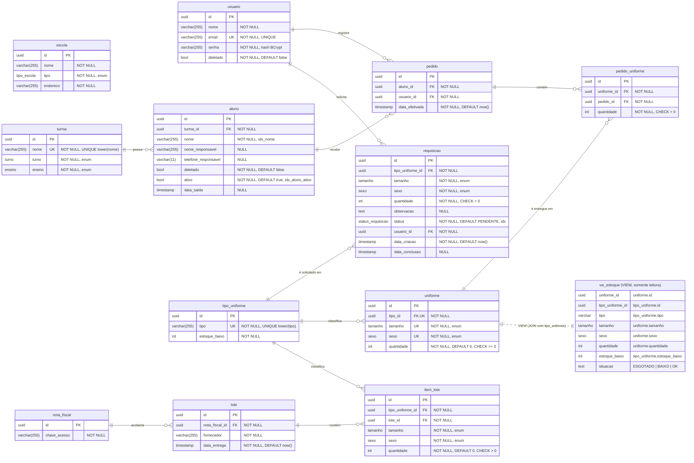
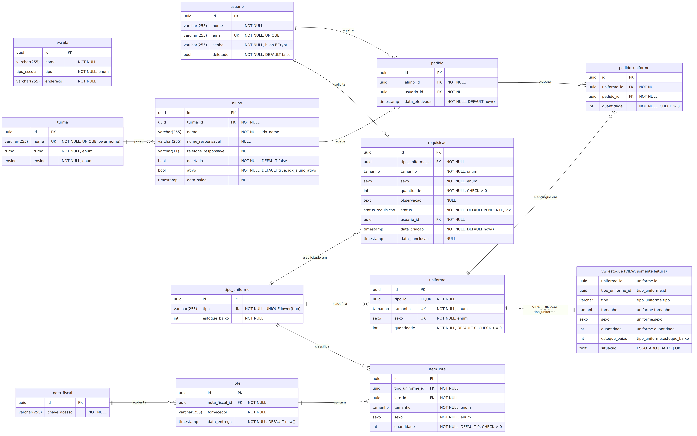

# Diagrama Entidade-Relacionamento (ERD)

Este documento apresenta o modelo **final** do banco de dados do sistema 6M Uniformes (PostgreSQL), resultado das migrations Flyway em
[`backend/src/main/resources/db/migration/`](../backend/src/main/resources/db/migration/), aplicadas em ordem:

| Versão | Arquivo | O que faz |
|---|---|---|
| V1 | `V1__create_initial_schema.sql` | Enums, as 11 tabelas originais, índices e chaves estrangeiras. |
| V2 | `V2__create_requisicao.sql` | Enum `status_requisicao` e tabela `requisicao` (pedidos de novas peças ao fornecedor). |
| V3 | `V3__aluno_saida.sql` | Colunas `aluno.ativo` e `aluno.data_saida` (saída do aluno da escola); recupera como "desligados" os alunos excluídos que tinham entregas. |
| V4 | `V4__view_estoque.sql` | VIEW `vw_estoque`, com a situação de cada item do estoque (`ESGOTADO`/`BAIXO`/`OK`). |
| V5 | `V5__corrige_datas_nulas.sql` | Preenche datas nulas e torna `pedido.data_efetivada` e `lote.data_entrega` `NOT NULL DEFAULT now()`. |

Uma cópia do DDL completo (V1 a V5 concatenadas) está em [`ddl.sql`](./ddl.sql). As justificativas de cada escolha estão em [`decisoes-de-modelagem.md`](./decisoes-de-modelagem.md).

## Diagrama (Mermaid)

Legenda: `PK` = chave primária, `FK` = chave estrangeira, `UK` = participa de restrição de unicidade.
Todas as chaves primárias são `uuid` com `DEFAULT gen_random_uuid()`. A entidade `vw_estoque` (linha tracejada) é uma **VIEW**, não uma tabela: não tem dados próprios nem chave estrangeira, apenas lê `uniforme` + `tipo_uniforme`.



> A tabela `escola` não possui relacionamentos: nenhuma outra tabela a referencia por chave estrangeira.

### Cardinalidades

| Relacionamento | Cardinalidade no banco | Observação |
|---|---|---|
| `turma` → `aluno` | 1 : 0..N | `aluno.turma_id` é obrigatório. |
| `aluno` → `pedido` | 1 : 0..N | Uma entrega pertence a exatamente um aluno. |
| `usuario` → `pedido` | 1 : 0..N | Usuário que registrou (ou editou por último) a entrega. |
| `pedido` → `pedido_uniforme` | 1 : 0..N | O banco aceita zero itens, mas a API exige ao menos um (`@NotEmpty` em `RequestCriarPedidoDTO`). |
| `uniforme` → `pedido_uniforme` | 1 : 0..N | Cada item de entrega aponta para um SKU de estoque. |
| `tipo_uniforme` → `uniforme` | 1 : 0..N | Até um `uniforme` por combinação (tipo, tamanho, sexo). |
| `tipo_uniforme` → `item_lote` | 1 : 0..N | O item do lote guarda o tipo, não o `uniforme`. |
| `nota_fiscal` → `lote` | 1 : 0..N | O banco permite N lotes por nota; na aplicação cada lote cria a sua própria nota (1 : 1 na prática). |
| `lote` → `item_lote` | 1 : 0..N | A API exige ao menos um item (`@NotEmpty` em `RequestCriarLoteDTO`). |
| `tipo_uniforme` → `requisicao` | 1 : 0..N | A requisição guarda tipo + tamanho + sexo (como o item de lote), pois a peça pode nunca ter entrado no estoque. |
| `usuario` → `requisicao` | 1 : 0..N | Quem solicitou (vem do token, não do corpo). |

Todas as 11 chaves estrangeiras são `DEFERRABLE INITIALLY IMMEDIATE` e não declaram `ON DELETE`, ou seja, o comportamento padrão é `NO ACTION` (exclusão bloqueada enquanto houver filhos).

## Imagem do DER



`DER.png` (idêntico a `backend/DER.png`) é gerado a partir do diagrama Mermaid acima com o [mermaid-cli](https://github.com/mermaid-js/mermaid-cli) (`npx mmdc -i erd.mmd -o DER.png -b white -w 1600 -s 3`). A antiga imagem do dbdiagram.io foi substituída para que diagrama e imagem venham da mesma fonte.

### O DER.png está atualizado?

**Sim, em relação ao schema final (V1 a V5).** A imagem foi regenerada nesta rodada e conferida contra as migrations: mostra as **12 tabelas** (`escola`, `usuario`, `turma`, `aluno`, `tipo_uniforme`, `uniforme`, `pedido`, `pedido_uniforme`, `nota_fiscal`, `lote`, `item_lote` e a nova `requisicao`), as 11 chaves estrangeiras, as colunas novas `aluno.ativo`/`aluno.data_saida`, as datas `NOT NULL DEFAULT now()` de `pedido` e `lote`, e a VIEW `vw_estoque` como entidade à parte, rotulada "VIEW, somente leitura".

A versão anterior (dbdiagram.io, commit `1063a46`) estava correta para a V1, mas ficou **desatualizada** com as migrations V2–V5: não tinha `requisicao`, `aluno.ativo`/`data_saida`, a view, nem a obrigatoriedade das datas.

Detalhes que aparecem só no DDL e no dicionário abaixo:

- restrições `CHECK`: `ck_uniforme_quantidade` (`>= 0`), `ck_pedido_uniforme_quantidade`, `ck_item_lote_quantidade` e `ck_requisicao_quantidade` (todas `> 0`);
- a expressão de cada índice (`uq_tipo_uniforme_tipo` em `lower(tipo)`, `uq_turma_nome` em `lower(nome)`, `uq_uniforme_tipo_tamanho_sexo`, `idx_nome`, `idx_aluno_ativo`, `idx_requisicao_status`);
- os valores possíveis de cada enum.

## Tipos enumerados (PostgreSQL `ENUM`)

| Tipo | Valores |
|---|---|
| `sexo` | `MASCULINO`, `FEMININO` |
| `tamanho` | `PP`, `P`, `M`, `G`, `GG` |
| `tipo_escola` | `PUBLICA`, `TECNICA`, `PARCEIRA`, `CIVICO_MILITAR`, `MILITAR` |
| `turno` | `DIURNO`, `VESPERTINO`, `NOTURNO`, `INTEGRAL` |
| `ensino` | `FUNDAMENTAL`, `MEDIO`, `TECNICO` |
| `status_requisicao` | `PENDENTE`, `ATENDIDA`, `CANCELADA` (V2) |

## Dicionário de dados

### `escola`
Cadastro de escolas. Exposta pela API apenas para leitura (`GET /api/escola`); não há endpoint de criação e nenhuma outra tabela a referencia.

| Coluna | Tipo | Restrições | Descrição |
|---|---|---|---|
| `id` | uuid | PK | Identificador. |
| `nome` | varchar(255) | NOT NULL | Nome da escola. |
| `tipo` | tipo_escola | NOT NULL | Categoria da escola. |
| `endereco` | varchar(255) | NOT NULL | Endereço. |

### `usuario`
Operadores do sistema (quem faz login e registra entregas).

| Coluna | Tipo | Restrições | Descrição |
|---|---|---|---|
| `id` | uuid | PK | Identificador. |
| `nome` | varchar(255) | NOT NULL | Nome do operador. |
| `email` | varchar(255) | NOT NULL, UNIQUE | Login. Na exclusão recebe o sufixo `\|_deleted_\|<id>` para liberar o e-mail. |
| `senha` | varchar(255) | NOT NULL | Hash BCrypt da senha. |
| `deletado` | bool | NOT NULL, DEFAULT false | Exclusão lógica. |

### `turma`
| Coluna | Tipo | Restrições | Descrição |
|---|---|---|---|
| `id` | uuid | PK | Identificador. |
| `nome` | varchar(255) | NOT NULL, UNIQUE (sem diferenciar maiúsculas) | Nome da turma (ex.: "1º A"). |
| `turno` | turno | NOT NULL | Turno da turma. |
| `ensino` | ensino | NOT NULL | Etapa de ensino. |

### `aluno`
| Coluna | Tipo | Restrições | Descrição |
|---|---|---|---|
| `id` | uuid | PK | Identificador. |
| `turma_id` | uuid | FK → `turma.id`, NOT NULL | Turma do aluno. |
| `nome` | varchar(255) | NOT NULL, índice `idx_nome` | Nome do aluno (usado em buscas). |
| `nome_responsavel` | varchar(255) | NULL | Nome do responsável. |
| `telefone_responsavel` | varchar(11) | NULL | Telefone só com dígitos, com DDD (10 ou 11 dígitos, validado na API). |
| `deletado` | bool | NOT NULL, DEFAULT false | Exclusão lógica. Só é usada para cadastro feito por engano: a API recusa excluir aluno que já tem entregas. |
| `ativo` | bool | NOT NULL, DEFAULT true, índice `idx_aluno_ativo` (V3) | `false` quando a saída do aluno foi registrada. Aluno inativo continua listado e no histórico, mas não pode receber novas entregas. |
| `data_saida` | timestamp | NULL (V3) | Momento em que a saída foi registrada; volta a `NULL` ao reativar. |

### `tipo_uniforme`
Catálogo de peças (ex.: "Camiseta", "Calça").

| Coluna | Tipo | Restrições | Descrição |
|---|---|---|---|
| `id` | uuid | PK | Identificador. |
| `tipo` | varchar(255) | NOT NULL, UNIQUE (sem diferenciar maiúsculas) | Nome do tipo. |
| `estoque_baixo` | int | NOT NULL | Limite de alerta: um `uniforme` desse tipo está com estoque baixo quando `quantidade <= estoque_baixo`. A API exige valor >= 0. |

### `uniforme`
Saldo de estoque por SKU: uma linha por combinação (tipo, tamanho, sexo).

| Coluna | Tipo | Restrições | Descrição |
|---|---|---|---|
| `id` | uuid | PK | Identificador. |
| `tipo_id` | uuid | FK → `tipo_uniforme.id`, NOT NULL | Tipo da peça. |
| `tamanho` | tamanho | NOT NULL | Tamanho. |
| `sexo` | sexo | NOT NULL | Modelagem masculina/feminina. |
| `quantidade` | int | NOT NULL, DEFAULT 0, CHECK >= 0 | Saldo atual em estoque. |

Unicidade: `uq_uniforme_tipo_tamanho_sexo (tipo_id, tamanho, sexo)`.

### `pedido`
Cabeçalho de uma entrega de uniformes a um aluno.

| Coluna | Tipo | Restrições | Descrição |
|---|---|---|---|
| `id` | uuid | PK | Identificador. |
| `aluno_id` | uuid | FK → `aluno.id`, NOT NULL | Aluno que recebeu. |
| `usuario_id` | uuid | FK → `usuario.id`, NOT NULL | Operador que registrou/editou por último. |
| `data_efetivada` | timestamp | NOT NULL, DEFAULT now() (V5) | Data/hora da entrega (usada nos filtros de relatório). Se o corpo não traz data, o backend usa o momento do registro. |

### `pedido_uniforme`
Itens de uma entrega.

| Coluna | Tipo | Restrições | Descrição |
|---|---|---|---|
| `id` | uuid | PK | Identificador. |
| `uniforme_id` | uuid | FK → `uniforme.id`, NOT NULL | SKU entregue. |
| `pedido_id` | uuid | FK → `pedido.id`, NOT NULL | Entrega à qual o item pertence. |
| `quantidade` | int | NOT NULL, CHECK > 0 | Quantidade entregue. |

### `nota_fiscal`
| Coluna | Tipo | Restrições | Descrição |
|---|---|---|---|
| `id` | uuid | PK | Identificador. |
| `chave_acesso` | varchar(255) | NOT NULL | Chave de acesso da NF-e. A unicidade é verificada apenas na aplicação (`NotaFiscalService`), não há `UNIQUE` no banco. |

### `lote`
Cabeçalho de uma entrada de mercadoria vinda do fornecedor.

| Coluna | Tipo | Restrições | Descrição |
|---|---|---|---|
| `id` | uuid | PK | Identificador. |
| `nota_fiscal_id` | uuid | FK → `nota_fiscal.id`, NOT NULL | Nota fiscal do lote. |
| `fornecedor` | varchar(255) | NOT NULL | Nome do fornecedor. |
| `data_entrega` | timestamp | NOT NULL, DEFAULT now() (V5) | Data/hora do recebimento (usada nos filtros de relatório). Se o corpo não traz data, o backend usa o momento do registro. |

### `item_lote`
Itens de uma entrada.

| Coluna | Tipo | Restrições | Descrição |
|---|---|---|---|
| `id` | uuid | PK | Identificador. |
| `tipo_uniforme_id` | uuid | FK → `tipo_uniforme.id`, NOT NULL | Tipo da peça recebida. |
| `lote_id` | uuid | FK → `lote.id`, NOT NULL | Lote ao qual o item pertence. |
| `tamanho` | tamanho | NOT NULL | Tamanho. |
| `sexo` | sexo | NOT NULL | Modelagem. |
| `quantidade` | int | NOT NULL, DEFAULT 0, CHECK > 0 | Quantidade recebida. Observação: o `DEFAULT 0` é incompatível com o `CHECK > 0`, então na prática a quantidade sempre precisa ser informada. |

### `requisicao` (V2)
Solicitação de novas peças ao fornecedor (ex.: a tela de estoque mostrou "Camiseta M feminina" esgotada). **Não altera o estoque**: as peças só entram quando o lote do fornecedor é registrado.

| Coluna | Tipo | Restrições | Descrição |
|---|---|---|---|
| `id` | uuid | PK | Identificador. |
| `tipo_uniforme_id` | uuid | FK → `tipo_uniforme.id`, NOT NULL | Tipo da peça solicitada. |
| `tamanho` | tamanho | NOT NULL | Tamanho. |
| `sexo` | sexo | NOT NULL | Modelagem. |
| `quantidade` | int | NOT NULL, CHECK > 0 | Quantidade pedida. |
| `observacao` | text | NULL | Observação livre (a API limita a 500 caracteres). |
| `status` | status_requisicao | NOT NULL, DEFAULT `'PENDENTE'`, índice `idx_requisicao_status` | `PENDENTE` → `ATENDIDA` ou `CANCELADA`; só uma requisição pendente pode mudar de status. |
| `usuario_id` | uuid | FK → `usuario.id`, NOT NULL | Quem solicitou. |
| `data_criacao` | timestamp | NOT NULL, DEFAULT now() | Quando foi solicitada. |
| `data_conclusao` | timestamp | NULL | Quando foi atendida ou cancelada. |

## VIEW `vw_estoque` (V4)

Visão somente leitura que junta `uniforme` e `tipo_uniforme` e calcula a situação de cada combinação tipo + tamanho + sexo. É a fonte do painel de estoque (`GET /api/uniforme/painel`) e do relatório de estoque (`GET /api/relatorio/estoque`); no backend é lida pela projeção `EstoqueView`.

```sql
CREATE VIEW vw_estoque AS
SELECT u.id AS uniforme_id, t.id AS tipo_uniforme_id, t.tipo AS tipo,
       u.tamanho, u.sexo, u.quantidade, t.estoque_baixo,
       CASE
           WHEN u.quantidade <= 0 THEN 'ESGOTADO'
           WHEN u.quantidade <= t.estoque_baixo THEN 'BAIXO'
           ELSE 'OK'
       END AS situacao
FROM uniforme u
JOIN tipo_uniforme t ON t.id = u.tipo_id;
```

| Coluna | Origem | Descrição |
|---|---|---|
| `uniforme_id` | `uniforme.id` | SKU do estoque. |
| `tipo_uniforme_id` | `tipo_uniforme.id` | Tipo da peça. |
| `tipo` | `tipo_uniforme.tipo` | Nome do tipo. |
| `tamanho` | `uniforme.tamanho` | Tamanho. |
| `sexo` | `uniforme.sexo` | Modelagem. |
| `quantidade` | `uniforme.quantidade` | Saldo atual. |
| `estoque_baixo` | `tipo_uniforme.estoque_baixo` | Limite de alerta do tipo. |
| `situacao` | calculada | `ESGOTADO`, `BAIXO` ou `OK` (regra abaixo). |

**Regra de situação** (a mesma de `Uniforme.estaComEstoqueBaixo()`/`SituacaoEstoque.calcular` no backend e de `lib/estoque.ts` no frontend):

| Situação | Condição |
|---|---|
| `ESGOTADO` | `quantidade <= 0` |
| `BAIXO` | `quantidade <= estoque_baixo` (o próprio limite já conta como baixo) |
| `OK` | `quantidade > estoque_baixo` |

O limite é **por tipo de uniforme**, não um número fixo: com `estoque_baixo = 8`, 8 peças já são "baixo" e 9 são "OK".
